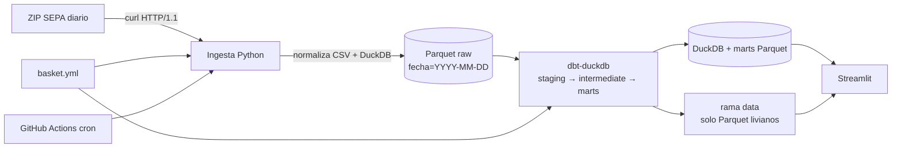

# Arquitectura

## Flujo

## Componentes

| Pieza | Rol |
|---|---|
| `src/canasta/source.py` | Cliente CKAN, fechas publicadas y descarga del ZIP. |
| `src/canasta/ingest.py` | Normalización de CSV, DuckDB, agregados, detalle tracked, rechazos y Parquet. |
| `src/canasta/index.py` | Índice base 100 con cobertura, fecha base y carry-forward de 3 días. |
| `src/canasta/ranking.py` | Ranking de cadenas y ahorro con/sin restricción de cadena. |
| `src/canasta/marts.py` | Escribe los Parquet que consume el dashboard (4 de la canasta del repo + 3 genéricos). |
| `src/canasta/definitions.py` | Assets Dagster, checks, schedule y sensor de fuente. |
| `dbt/` | Staging, intermediate y marts; tests de claves, precios, EAN y relaciones. |
| `dashboard/app.py` | 5 vistas: armá tu canasta, canasta, índice, dónde comprar y salud. |
| `dashboard/builder.py` | Búsqueda en catálogo y export/import de `basket.yml`. |
| `dashboard/compute.py` | Índice y ranking en sesión desde los marts genéricos. |
| `dashboard/auth.py` | Registro/login vía Supabase Auth (GoTrue REST). |
| `dashboard/store.py` | Canasta por usuario en Supabase Postgres con RLS (PostgREST). |
| `supabase/schema.sql` | Tabla `baskets` + políticas RLS. |

## Capas de datos

| Capa | Destino | Retención |
|---|---|---|
| Raw | `data/raw/<tabla>/fecha=.../part.parquet` | Últimos 90 días de detalle; agregados configurables. |
| DuckDB | `data/canasta.duckdb` | Se reconstruye con `make dbt`. |
| Marts | `data/marts/*.parquet` | Se publican en la rama `data`. |

## Orquestación

- `sepa_raw_parquet`: asset particionado por día; descarga, procesa y borra crudos.
- `canasta_dbt_assets`: 12 assets dbt derivados del manifest; dependen de la ingesta.
- `check_volumen`, `check_precio`, `check_rechazos`: asset checks bloqueantes.
- `daily_sepa`: schedule 16:30 UTC.
- `sepa_source_sensor`: reintenta cada 30 min; a los 8 intentos loguea `FALLO_FUENTE`.

## Decisiones clave

Ver `docs/DECISIONS.md` (ADR-001 a ADR-018): recursos rotativos, alcance, dos niveles de
detalle, índice en Python, rama `data`, licencia, HTTP/1.1, rutas `./data`, normalización de
CSV, dbt sobre Parquet externo, ejecución dbt completa por partición, marts genéricos por
provincia, cuentas Supabase y canasta armada en la UI con cálculo en sesión.
