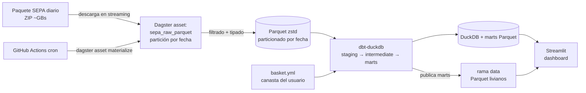
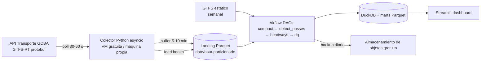
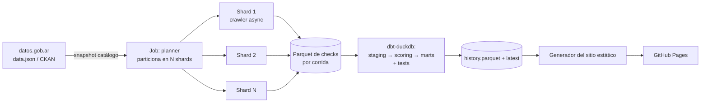

# Bloque 2: Proyectos de Data Engineering (4, 5 y 6)

> Documento de especificación para agentes de código. Cada agente implementa **un solo proyecto** (sección 4, 5 o 6) y debe leer antes la sección 1 (convenciones comunes) y la sección 2 (reglas de operación).
> Los tres proyectos son independientes: **un repositorio por proyecto**, sin código compartido.

## 0. Propósito y contexto

El dueño de los repos es un estudiante/ingeniero junior en Buenos Aires que los usará como portfolio para postularse a posiciones **junior de Data Engineering / Backend**. Las ofertas junior de datos en Argentina piden, de forma recurrente: **SQL avanzado, Python, un orquestador (Airflow u otro), modelado de datos, algún cloud o warehouse (GCP/BigQuery, Azure, AWS), Git y Docker**.

Por eso cada proyecto debe demostrar criterio de ingeniería, no solo "que corre":

- Pipelines **idempotentes** y reproducibles.
- **Calidad de datos** con tests automáticos.
- **Modelado** explícito (capas, claves, granularidad).
- **Operación real** (ejecuciones programadas, monitoreo básico, manejo de fallos).
- **Documentación de decisiones y límites**, con números medidos y no inventados.

| # | Proyecto | Orquestación | Motor analítico | Salida visible |
|---|----------|--------------|-----------------|----------------|
| 4 | Canasta personal (precios SEPA) | Dagster | DuckDB + Parquet + dbt | Dashboard Streamlit |
| 5 | Pulso del Transporte (CABA) | Airflow | DuckDB + Parquet (+ SQL versionado) | Dashboard Streamlit |
| 6 | Salud de datasets abiertos (datos.gob.ar) | GitHub Actions (matriz) | DuckDB + dbt tests | Sitio estático en GitHub Pages |

La variedad de orquestadores es intencional: el portfolio completo muestra Dagster, Airflow y CI como orquestación.

---

## 1. Convenciones comunes (aplican a los tres proyectos)

### 1.1 Stack base

- **Python 3.12**, gestor de entornos **uv** (`pyproject.toml` + `uv.lock`).
- **Lint/format:** `ruff`. **Tipos:** `mypy` (modo razonable, no hace falta `--strict` en todo). **Tests:** `pytest`.
- **pre-commit** con `ruff`, `ruff-format`, y detección de secretos (`gitleaks` o equivalente).
- **Docker / Docker Compose** para el entorno local reproducible.
- **GitHub Actions** para CI y ejecuciones programadas.
- **SQL:** dialecto DuckDB. Formatear con `sqlfluff` si el proyecto usa dbt.
- Todo debe correr con costo **cero** (capas gratuitas) o con una alternativa local documentada.

### 1.2 Estructura mínima de cada repo

```
.
├── README.md                # ver 1.4
├── docs/
│   ├── ARCHITECTURE.md      # diagrama Mermaid + explicación de componentes
│   ├── DECISIONS.md         # ADRs breves: decisión, alternativas, por qué
│   ├── SOURCES.md           # verificación de fuentes (ver Fase 0)
│   ├── DATA_MODEL.md        # granularidad, claves, diccionario de columnas
│   └── LIMITATIONS.md       # qué NO hace y qué sesgos tiene
├── src/<paquete>/
├── tests/
├── sql/ o dbt/ (según el proyecto)
├── .github/workflows/
├── docker-compose.yml
├── .env.example             # nunca commitear .env
├── pyproject.toml
└── Makefile                 # make setup | test | lint | run | up | down
```

### 1.3 Reglas de ingeniería no negociables

1. **Idempotencia:** re-ejecutar el mismo día/partición produce el mismo resultado y no duplica filas (usar `MERGE`/`DELETE+INSERT` por partición, o sobrescribir la partición Parquet completa).
2. **Esquema explícito:** nunca depender de la inferencia automática de tipos para datos de terceros. Declarar columnas y tipos al leer CSV/JSON.
3. **Fallar fuerte, degradar suave:** un dato inválido de una fila se registra y se aparta (tabla/archivo de rechazados con motivo); un cambio de esquema o una caída de volumen anormal **detiene** la ejecución y alerta.
4. **Nada de secretos en el repo.** Credenciales por variables de entorno / GitHub Secrets. Incluir `.env.example`.
5. **Zonas horarias:** almacenar en **UTC**, mostrar en `America/Argentina/Buenos_Aires`. Documentar en qué zona viene cada fuente.
6. **Ser buen ciudadano con las fuentes públicas:** `User-Agent` identificable, límites de concurrencia, timeouts, reintentos con backoff y jitter, respeto de `Retry-After`/429. No hacer scraping agresivo.
7. **Tests con datos de ejemplo pequeños** (fixtures commiteadas, < 1 MB). Los tests no deben llamar a la red.
8. **Logging estructurado** (JSON o `key=value`) con run id y partición procesada.
9. **No inventar métricas.** Todo número en el README (filas/día, tiempos, tamaños, cobertura) debe salir de una medición real del propio proyecto, con fecha y comando para reproducirla.
10. **No hacer afirmaciones que los datos no sostienen.** Cada proyecto tiene una sección de límites. Respetarla en dashboards y README.

### 1.4 README (lo primero que ve un reclutador)

Debe incluir, en este orden:

1. Título + una frase del problema que resuelve.
2. Captura o GIF del resultado y **link al demo desplegado** (si aplica).
3. "Por qué importa" en 3 líneas.
4. Diagrama de arquitectura (Mermaid) de ~5 a 7 cajas.
5. Stack y para qué se usa cada pieza.
6. **Cómo correrlo en 5 minutos** (comandos exactos, con datos de ejemplo incluidos).
7. Decisiones y trade-offs (resumen; detalle en `docs/DECISIONS.md`).
8. Calidad de datos: qué se valida y dónde.
9. Números medidos (volumen, tiempos, costo = 0).
10. Limitaciones y próximos pasos.

Idioma: **inglés** en el cuerpo del README (visibilidad internacional) con un resumen de 3 líneas en español arriba. `docs/` puede ir en español.

### 1.5 CI (GitHub Actions)

- Workflow `ci.yml` en cada push/PR: `ruff`, `mypy`, `pytest`, y (si aplica) `dbt build` sobre fixtures.
- Workflow(s) programados para el pipeline (cron) con `workflow_dispatch` manual.
- Cachear dependencias. Badge de CI en el README.

### 1.6 Definición de "terminado" (común)

- [ ] `make setup && make test` pasa en una máquina limpia.
- [ ] `docker compose up` levanta lo necesario con datos de ejemplo.
- [ ] CI verde.
- [ ] Pipeline programado ejecutándose al menos **una vez de verdad** en producción gratuita (no solo local).
- [ ] Demo público accesible (dashboard o sitio) o, si no es posible, capturas + instrucciones.
- [ ] `docs/` completos, README según 1.4, números medidos.
- [ ] Sin secretos en el historial de git.

---

## 2. Reglas de operación para el agente

1. **Fase 0 obligatoria: verificar fuentes antes de escribir código.** Este documento contiene información investigada el 03/11/2026 que puede estar desactualizada. Todo lo marcado **⚠️ NO VERIFICADO** debe comprobarse contra la fuente real y registrarse en `docs/SOURCES.md` (URL exacta, fecha de verificación, formato real, licencia, límites, un ejemplo de respuesta/archivo recortado).
2. **Si la realidad difiere de este documento,** seguir la realidad y registrar la desviación en `docs/DECISIONS.md`. No forzar el diseño a una fuente que no existe.
3. **Si una fuente es inaccesible** (requiere registro humano, captcha, está caída), crear `BLOCKERS.md` explicando qué falta y **detenerse** en lo que no dependa de eso. No inventar datos ni simular que la fuente funciona.
4. **Trabajar por fases con commits pequeños** y mensajes tipo Conventional Commits (`feat:`, `fix:`, `docs:`, `test:`, `ci:`).
5. **No agregar alcance** que no esté en "Alcance v1". Lo extra va a "Fuera de alcance / próximos pasos".
6. **Al terminar cada fase,** actualizar el checklist de aceptación del proyecto en `docs/PROGRESS.md`.
7. **Verificar los límites de las capas gratuitas** (Streamlit Community Cloud, GitHub Actions, almacenamiento de objetos, VM gratuita) al momento de implementar; pueden haber cambiado. Registrar lo verificado en `docs/DECISIONS.md`.

---

# 4. Proyecto 4: Canasta personal

**Repo sugerido:** `canasta-personal`

## 4.1 Problema e idea

Los precios de supermercados en Argentina cambian rápido y la inflación "oficial" no refleja lo que cada persona compra. Este proyecto toma la base pública diaria de precios de supermercados (SEPA / Precios Claros), la normaliza y modela, y permite a cualquier persona armar **su canasta de ~20-50 productos** para ver:

1. Cómo evolucionó el **costo de su canasta** en el tiempo (un índice propio base 100).
2. **En qué cadena/sucursal** le conviene comprar hoy, y cuánto ahorra frente a comprar todo en un solo lugar.

**Demo esperada:** un dashboard donde se elige una provincia/localidad, se arma o carga una canasta, y se ven el índice, el ranking de cadenas y el detalle por producto.

## 4.2 Fuente de datos

| Dato | Estado |
|------|--------|
| El Gobierno nacional publica diariamente la base SEPA completa, del orden de **12 millones de precios de ~3.600 supermercados** según notas de prensa de 2024. | Reportado en prensa, **⚠️ NO VERIFICADO** en la fuente |
| Se anunció un paquete de datos de **~4 GB diarios** publicado desde el mediodía en el sitio de Defensa del Consumidor (argentina.gob.ar). | Reportado en prensa, **⚠️ NO VERIFICADO**; medir el tamaño real |
| Licencia: un sitio de terceros indica CC BY 4.0. | **⚠️ NO VERIFICADO**; confirmar en la fuente oficial y citar la atribución correcta en el README |
| Formato interno del paquete (estructura de carpetas, archivos por cadena, delimitador, encoding, columnas). | **⚠️ NO VERIFICADO**. Inspeccionar un paquete real; no asumir |

**Fase 0 específica:** localizar la URL de descarga vigente, el patrón de nombres por fecha, la hora aproximada de publicación, si existen **días históricos** descargables, el tamaño real, y documentar el diccionario de columnas real (EAN, descripción, marca, precio de lista, precios promocionales si existen, unidad de referencia, identificadores de comercio/sucursal, provincia/localidad).

**Consideración legal/ética:** los precios son los que cada cadena informa al sistema, no una foto en vivo de la góndola. Dejarlo explícito en el dashboard.

## 4.3 Arquitectura



## 4.4 Stack y rol de cada pieza

| Pieza | Para qué se usa |
|-------|-----------------|
| **Python 3.12 + httpx** | Descarga con streaming y reanudación; validación del ZIP. |
| **DuckDB** | Lectura de CSV con esquema explícito, filtrado, escritura a Parquet, y motor de dbt. Procesa archivos mayores a la RAM sin cargarlos enteros. |
| **Parquet (zstd), particionado `fecha=YYYY-MM-DD`** | Almacenamiento columnar barato; sobrescribir una partición = idempotencia. |
| **Dagster** (assets particionados por día) | Orquestación declarativa: asset de ingesta, assets de dbt (`dagster-dbt`), **asset checks** de calidad, schedule diario y sensor de reintento si el paquete aún no fue publicado. |
| **dbt Core + dbt-duckdb** | Modelado por capas, tests de datos y documentación autogenerada. |
| **Streamlit** (+ Plotly o Altair) | Dashboard. Lee solo los marts livianos, nunca los datos crudos. |
| **GitHub Actions** | CI y ejecución diaria del pipeline (`dagster asset materialize`). Verificar disco/tiempo disponibles frente al tamaño real del ZIP. |
| **Rama `data` (huérfana) o almacenamiento de objetos gratuito** | Publicar los marts (MBs) para que el dashboard los lea. Si se usa la rama `data`, sobrescribirla con *force-push* cada vez para no inflar el repo. |

## 4.5 Alcance v1

**Incluye**

- Ingesta diaria idempotente, con el ZIP **procesado en streaming y descartado** (no conservar los crudos).
- Alcance geográfico configurable (`SCOPE`); por defecto **CABA + GBA/AMBA**.
- Dos niveles de detalle (decisión clave de volumen):
  - **Agregado diario para todos los EAN del alcance:** `min`, `p25`, `mediana`, `p75`, `max` y `n_sucursales` por EAN × provincia × fecha. Tamaño pequeño.
  - **Detalle por sucursal solo para `tracked_products`:** la canasta del usuario + los top-N EAN por cobertura (N configurable, ej. 2.000-3.000).
- Retención configurable (ej. detalle de los últimos 90 días; agregados sin límite).
- Índice de canasta propia base 100 y ranking de cadenas.
- Dashboard con 4 vistas (ver 4.8).

**Fuera de alcance v1:** scraping de web de cadenas, comparación con el IPC del INDEC, usuarios/cuentas, productos sin EAN, recomendaciones automáticas, backfill histórico masivo (solo si ya hay datos descargables y entra en los límites).

## 4.6 Modelo de datos

**Capas dbt**

- `staging`: `stg_sepa__productos`, `stg_sepa__sucursales`, `stg_sepa__comercios`. Renombre, tipado, limpieza de strings, normalización de encoding. Sin lógica de negocio.
- `intermediate`: `int_precio_normalizado` (precio de lista, unidad de referencia normalizada a un precio por unidad comparable, flag de producto con EAN válido).
- `marts`:
  - `dim_producto` (clave `ean`; descripción y marca "canónicas" = la más frecuente)
  - `dim_sucursal` (comercio, bandera/cadena, provincia, localidad)
  - `dim_fecha`
  - `fct_precio_diario` (granularidad: `fecha × sucursal × ean`, solo `tracked_products`)
  - `agg_precio_ean_diario` (granularidad: `fecha × provincia × ean`, todos los EAN)
  - `mart_canasta_costo_diario` (costo de la canasta por `fecha × cadena`)
  - `mart_indice_canasta` (índice base 100 por `fecha`)
  - `mart_ranking_cadenas` (ranking diario y ahorro potencial)

**Reglas de negocio**

- **Clave de producto = EAN.** Validar dígito verificador GS1 (EAN-8/13). Productos sin EAN válido (ej. pesables con códigos internos) se **excluyen** y se cuentan en un reporte de rechazos; documentarlo en `LIMITATIONS.md`.
- **Precio base = precio de lista.** Si existen campos de promoción, tratarlos como métrica separada (no mezclarlos en el índice base). **⚠️ Confirmar qué campos existen** en la Fase 0.
- **Precio de un producto en un día** = **mediana** entre sucursales del alcance (opcionalmente por cadena).
- **Índice:** `Índice_t = 100 × Σ(qᵢ · pᵢ,t) / Σ(qᵢ · pᵢ,base)`, con cantidades `qᵢ` fijas definidas en `basket.yml`.
  - **Fecha base:** primera fecha con **cobertura ≥ 90 %** del peso de la canasta.
  - **Cobertura del día** = peso de los ítems con precio ese día / peso total.
  - **Faltantes:** carry-forward del último precio por **máximo 3 días**. Más allá, el día se marca `incompleto` y **no se grafica como válido**.
- **Ahorro potencial** = costo en la cadena más barata vs. costo de comprar cada ítem en la sucursal más barata (con y sin restricción de una sola cadena). Mostrar ambos.
- Nombrarlo **"índice de canasta propia"**; **nunca** presentarlo como inflación oficial ni como comparable al IPC.

`basket.yml` (ejemplo de formato, el contenido lo define el usuario):

```yaml
scope:
  provincias: ["CABA", "Buenos Aires"]
items:
  - ean: "0000000000000"   # reemplazar por EAN reales
    label: "Leche entera 1 L"
    qty_per_month: 8
```

## 4.7 Calidad de datos

Tests dbt y asset checks de Dagster (nombres orientativos):

- `not_null` / `unique` en claves de dimensiones y en la granularidad de `fct_precio_diario`.
- **Precio > 0** y dentro de rango razonable (flag de outliers: > 10× o < 0,1× la mediana del EAN ese día).
- **Volumen:** el número de filas del día debe estar dentro de ±X % (configurable, ej. 30 %) del promedio móvil de 7 días; fuera de rango = **falla el asset** y se frena la publicación de marts.
- **Frescura:** si el paquete del día no existe a la hora esperada, el sensor reintenta y, pasado un tope, deja un estado `FALLÓ_FUENTE` visible.
- **Esquema:** si cambian nombres/cantidad de columnas del origen, fallar con mensaje claro.
- **Rechazados:** tabla/archivo `rejects` con `motivo` y conteo por día; mostrar el conteo en el dashboard.

## 4.8 Dashboard (Streamlit)

1. **Canasta:** cargar/editar `basket.yml` (subir archivo o buscar por descripción/EAN) y elegir el alcance.
2. **Índice:** línea del índice base 100 con días incompletos marcados y la cobertura al lado.
3. **Dónde comprar hoy:** ranking de cadenas, ahorro potencial y detalle por producto.
4. **Salud de los datos:** última fecha cargada, filas del día, rechazos, cobertura. Transparencia sobre la calidad.

Debe leer solo marts Parquet livianos y cargar en pocos segundos.

## 4.9 Fases y aceptación

| Fase | Contenido | Aceptación |
|------|-----------|------------|
| 0 | Verificar fuente y formato; medir tamaño real; documentar en `SOURCES.md` | Un paquete real descargado y descrito; decisión de volumen documentada |
| 1 | Ingesta → Parquet particionado (1 día) | Reejecución no duplica; memoria acotada medida |
| 2 | Modelos dbt + tests sobre fixtures y sobre 1 día real | `dbt build` verde; tests de calidad activos |
| 3 | Dagster: assets, checks, schedule, sensor | Materializa una partición por CLI y desde la UI |
| 4 | Índice y ranking (con tests unitarios de la fórmula) | Casos de prueba con cobertura parcial y carry-forward |
| 5 | Dashboard + publicación de marts desde Actions | Demo público; datos se actualizan solos |
| 6 | Docs, README, números medidos | Checklist de 1.6 completo |

## 4.10 Riesgos y decisiones abiertas

- **Tamaño del paquete vs. límites de Actions:** medir. Si no entra, correr la ingesta en una VM gratuita o en máquina local y publicar solo los marts. Documentar la elección.
- **Calidad de EAN y descripciones:** habrá productos con descripciones inconsistentes entre cadenas; usar descripción más frecuente por EAN y no intentar fuzzy matching en v1.
- **Cambios de formato del origen:** tests de esquema; fallar explícito.
- **Histórico:** si no hay días anteriores descargables, el valor del proyecto crece con el tiempo. **Dejar la ingesta corriendo cuanto antes** y decirlo en el README.

---

# 5. Proyecto 5: Pulso del Transporte

**Repo sugerido:** `pulso-transporte-caba`

## 5.1 Problema e idea

Todos conocen la experiencia de "los colectivos vienen de a tres" o "el subte está en frecuencia reducida". Este proyecto **mide** esa experiencia: recolecta datos en tiempo real del transporte público de la Ciudad de Buenos Aires de forma continua, construye un histórico propio, y calcula indicadores de **regularidad del servicio** por línea y franja horaria (intervalos observados, amontonamiento de unidades, huecos de servicio y disponibilidad de la propia fuente de datos).

**Ventaja diferencial:** el historial se acumula con el tiempo y **no puede copiarse de un día para otro**. El colector debe estar corriendo lo antes posible (Fase 1).

**Demo esperada:** dashboard con ranking de líneas por regularidad, mapa/tabla por franja horaria y día de la semana, y un panel de "confiabilidad de los datos" de la propia API.

## 5.2 Fuentes de datos

| Dato | Estado |
|------|--------|
| API de Transporte del GCBA (colectivos, trenes, subtes dentro de CABA): datos estáticos y dinámicos, formato **GTFS / GTFS-realtime en protobuf**. | Verificado en documentación pública |
| **Requiere registro** para obtener `client_id` y `client_secret`. | Verificado. **Acción humana:** el dueño del repo debe registrarse y proveer las credenciales vía variables de entorno. |
| El GCBA advierte que la información **puede estar desactualizada o ser imprecisa** y que se desarrolla una versión 2.0 de la API. | Verificado. Esto convierte la **calidad de la propia fuente en un entregable** del proyecto. |
| Endpoints concretos (vehicle positions de colectivos, forecast/trip updates y service alerts de subte, Ecobici GBFS), parámetros de autenticación, límites de uso y frecuencia de refresco. | **⚠️ NO VERIFICADO**. Leer la documentación vigente (portal API Transporte / Mulesoft Exchange) antes de implementar. |
| GTFS estático de colectivos en el portal de datos abiertos de la Ciudad (existe una versión **basada en frecuencias**, no en horarios por parada, además del GTFS completo). | Verificado a nivel de catálogo; **⚠️ confirmar URL y vigencia** |

**Implicancia importante del GTFS por frecuencias:** si los colectivos solo tienen *frecuencia teórica* (intervalo entre salidas) y no horario por parada, **no se puede medir "puntualidad contra horario"**. La métrica correcta para colectivos es la **regularidad del intervalo** (headway observado vs. frecuencia teórica). No usar la palabra "puntualidad" para colectivos salvo que la Fase 0 demuestre que hay horarios por parada.

**Fase 0 específica:** registrar credenciales; llamar a cada feed disponible; guardar muestras (recortadas) decodificadas; documentar campos reales (¿hay `trip_id`? ¿`direction`? ¿`timestamp` por vehículo y a nivel de feed?), frecuencia real de refresco, tamaño por respuesta, límites de uso y latencia típica. **Elegir la métrica principal según los campos que de verdad existan.**

## 5.3 Arquitectura



## 5.4 Stack y rol de cada pieza

| Pieza | Para qué se usa |
|-------|-----------------|
| **Python asyncio + httpx** | Colector con polling periódico, timeouts, reintentos con backoff+jitter y *circuit breaker* ante fallas persistentes. |
| **`gtfs-realtime-bindings` (protobuf)** | Decodificar los feeds GTFS-RT. |
| **Parquet (zstd), particionado `date/hour`** | Landing zone. **Buffer en memoria y escritura cada 5-10 min** para evitar el problema de archivos pequeños; job de **compactación** horaria. |
| **Airflow** (verificar versión vigente y requisitos de memoria) | DAGs programados: ingesta del GTFS estático (semanal), compactación (horaria), detección de pasos y métricas (diaria), checks de calidad y publicación. Si la VM no soporta Airflow, usar **Dagster** como alternativa y documentarlo como decisión. |
| **DuckDB (+ extensión spatial o `shapely`)** | Transformaciones analíticas y geoespaciales; SQL versionado en `sql/`. |
| **`pytest`** | Tests unitarios de la lógica de detección de pasos y cálculo de intervalos con trayectorias sintéticas. |
| **Streamlit** | Dashboard. |
| **VM con capa gratuita permanente (ej. Oracle Cloud Always Free) o máquina propia / Raspberry Pi** | Colector corriendo 24/7. **⚠️ Verificar disponibilidad y condiciones actuales.** GitHub Actions por cron **no sirve** para polling de ~1 minuto (mínimo de 5 min y ejecuciones con retraso). |
| **Almacenamiento de objetos con capa gratuita (ej. Cloudflare R2 u otro)** | Backup diario de Parquet. Verificar límites. |

## 5.5 Alcance v1 (priorizado por riesgo)

1. **Colector robusto de todos los feeds disponibles** (posiciones, alertas, predicciones). Esta fase se entrega **primero** y queda corriendo.
2. **Subte primero** para las métricas: pocas líneas, servicio regular, y probable disponibilidad de predicciones/pronósticos. Si la Fase 0 muestra que los datos son inutilizables, documentarlo y pivotar a lo que sí funcione.
3. **Colectivos para N líneas seleccionadas** (configurable, ej. 5-10 líneas de alta frecuencia) para acotar volumen.
4. **Panel de confiabilidad de la fuente.**
5. **Alertas de servicio:** frecuencia y causas por línea (si el feed las expone).

**Fuera de alcance v1:** predicción con ML, comparación contra reclamos, trenes metropolitanos, app móvil, notificaciones, cualquier afirmación causal ("la línea X empeoró por Y").

## 5.6 Métricas (definiciones obligatorias en `docs/DATA_MODEL.md`)

**Detección de pasos por un punto de control (v1 recomendada)**

- Para cada vehículo, ordenar muestras por `timestamp` y proyectar la posición sobre la **forma (shape) de la ruta** para obtener la **distancia a lo largo del recorrido**.
- Un "paso" por una parada ocurre cuando la distancia acumulada **cruza** la distancia de la parada entre dos muestras consecutivas; el instante se interpola linealmente.
- **Descartar** el cruce si: la diferencia entre muestras es > 5 min, la distancia retrocede (jitter de GPS), o el vehículo no tiene dirección/ruta consistentes.
- Fallback más simple si no hay `shape`: geocerca (radio configurable ~100-150 m) con detección de entrada. Documentar el trade-off.
- Si el feed no trae `trip_id`/dirección, **inferir la dirección** y documentarlo como supuesto.

**Indicadores por `línea × sentido × franja horaria × tipo de día`**

- `headway_observado`: tiempo entre pasos consecutivos por un mismo punto de control.
- `headway_teorico`: desde el GTFS (frecuencias o intervalos), si existe para la franja.
- `indice_regularidad`: ej. desvío del headway observado respecto del teórico (definir y documentar la fórmula exacta).
- `tasa_amontonamiento`: % de intervalos < 30 % del teórico.
- `tasa_huecos`: % de intervalos > 2× el teórico.
- `unidades_en_servicio_por_hora`.

**Confiabilidad de la fuente (feed trust)**

- Latencia y errores HTTP por feed; antigüedad del `timestamp` del feed vs. hora de captura.
- % de vehículos con posición **congelada** (misma lat/lon por N muestras en horario de servicio) y **saltos imposibles** (velocidad implícita absurda).
- Disponibilidad del feed por hora.

**Segmentación**

- Franjas: madrugada, pico mañana (7-10), valle, pico tarde (17-20), noche.
- Tipo de día: laborable / sábado / domingo / feriado (calendario de feriados de Argentina, ej. librería `holidays`).

## 5.7 Calidad de datos y operación

- **Esquema del feed:** si faltan campos requeridos o cambia la estructura, registrar y alertar sin romper el colector.
- **Volumen:** muestras por hora esperadas vs. reales; huecos de captura documentados como `capture_gap` (no rellenar).
- **Idempotencia:** los DAGs diarios sobrescriben la partición del día.
- **Observabilidad mínima:** el colector expone un archivo/endpoint de *heartbeat*; un chequeo programado avisa (ej. mensaje a Telegram o issue de GitHub) si no hay datos nuevos por más de X minutos.
- **Respeto a la fuente:** descubrir en la Fase 0 el límite de uso y fijar el intervalo de polling por debajo de él. Registrar toda respuesta 429.
- **Datos personales:** los feeds son de vehículos, no de personas. Aun así, no publicar IDs internos de dispositivos si pudieran asociarse a un conductor.

## 5.8 Dashboard (Streamlit)

1. **Ranking de líneas** por índice de regularidad en un rango de fechas seleccionable.
2. **Heatmap** franja horaria × día de la semana para una línea elegida.
3. **Detalle de una línea:** distribución de intervalos, amontonamiento, huecos y unidades en servicio.
4. **Confiabilidad de los datos:** disponibilidad del feed, congelamientos, huecos de captura. Mostrar claramente el período cubierto.
5. Aviso permanente: "Medición propia a partir de datos oficiales que pueden contener imprecisiones".

## 5.9 Fases y aceptación

| Fase | Contenido | Aceptación |
|------|-----------|------------|
| 0 | Credenciales, exploración de feeds, `SOURCES.md` con muestras | Se conoce qué campos existen y la frecuencia real; métrica principal elegida |
| 1 | **Colector 24/7 + landing Parquet + heartbeat** | Corre ≥ 48 h sin intervención; reconexión ante fallas probada |
| 2 | Airflow: compactación, GTFS estático, checks | DAGs idempotentes; archivos compactados |
| 3 | Detección de pasos + headways (subte primero) | Tests con trayectorias sintéticas; resultados plausibles revisados a mano en 2-3 casos |
| 4 | Colectivos (N líneas) y métricas de regularidad | Mismas pruebas; documentación de supuestos |
| 5 | Dashboard + publicación de marts + backup | Demo público; datos se actualizan solos |
| 6 | Docs, README, números medidos | Checklist de 1.6 completo |

## 5.10 Riesgos y decisiones abiertas

- **Calidad de la fuente:** puede ser baja (GCBA lo advierte). Es parte del resultado; **no maquillar** los problemas, medirlos.
- **Dirección y recorrido de colectivos sin `trip_id`:** la parte más compleja. Si no es viable, limitar v1 a subte y a métricas de disponibilidad/volumen para colectivos, y documentarlo.
- **VM gratuita:** puede no estar disponible o requerir verificación. Plan B: máquina propia con `docker compose` y backup diario a almacenamiento externo.
- **Crecimiento de datos:** estimar con la Fase 1 y fijar la retención/compactación en consecuencia.

---

# 6. Proyecto 6: Salud de datasets abiertos

**Repo sugerido:** `datos-abiertos-salud`

## 6.1 Problema e idea

El portal nacional de datos abiertos (datos.gob.ar) concentra miles de datasets de organismos públicos, pero no se sabe cuántos funcionan de verdad: enlaces rotos, datasets que dicen actualizarse mensualmente y llevan años sin cambios, archivos cuyo formato no coincide con lo declarado, o columnas que cambian sin aviso.

Este proyecto es un **observatorio automático de calidad**: revisa el catálogo de forma programada, calcula un **puntaje de salud** por distribución, dataset y organismo, guarda el historial y publica un reporte público.

**Demo esperada:** sitio estático en GitHub Pages con ranking de organismos, lista de los datasets con más problemas, tendencia en el tiempo y metodología transparente.

## 6.2 Fuentes de datos

| Dato | Estado |
|------|--------|
| El portal datos.gob.ar publica su catálogo en el estándar **`data.json`** (metadatos: datasets y distribuciones). La herramienta `pydatajson` valida catálogos usando ese archivo. | Verificado en documentación pública. **⚠️ Confirmar la URL vigente de `data.json` y su tamaño.** |
| El portal está basado en **CKAN** y se puede consultar con la acción `package_search`. | Verificado a nivel de uso por `pydatajson`. **⚠️ Confirmar la URL base de la API y los parámetros vigentes.** |
| El portal **federa solo los datasets que cumplen un piso de calidad**; existen más datasets en la red de nodos que los visibles. Además, los metadatos pueden mantenerse aunque los datos estén momentáneamente inaccesibles. | Verificado en el sitio. **Implicancia:** diferenciar "enlace roto" de "nodo o servidor caído temporalmente". |
| Campos de interés: `modified`, `accrualPeriodicity`, `distribution[].downloadURL`, `format`, `mediaType`, `byteSize`, `publisher`/organización. | **⚠️ NO VERIFICADO**; revisar el `data.json` real y documentar los campos presentes y sus valores habituales. |

**Fase 0 específica:** descargar `data.json`; contar datasets y distribuciones; listar los valores distintos de `accrualPeriodicity` y de `format`; medir qué % de distribuciones tiene `downloadURL`; elegir una muestra de ~100 enlaces y probar manualmente HEAD/GET para ver comportamientos reales (405 en HEAD, redirecciones, WAF/anti-bot, tiempos).

## 6.3 Arquitectura



## 6.4 Stack y rol de cada pieza

| Pieza | Para qué se usa |
|-------|-----------------|
| **Python asyncio + httpx** | Crawler concurrente con límites **por host** y globales, timeouts, reintentos y backoff. |
| **`orjson`** | Parseo rápido de `data.json` (puede ser grande). |
| **`pydatajson`** (opcional) | Validar el catálogo y normalizar metadatos. Verificar que siga mantenida; si no, parsear a mano. |
| **DuckDB** | Almacenar resultados, calcular puntajes y consultar el historial. |
| **dbt Core + dbt-duckdb** | Modelado de los puntajes, tests de datos y documentación. |
| **Pandera / validaciones propias** | Validar el esquema de los resultados del crawler antes de guardarlos. |
| **GitHub Actions con `matrix`** | Dividir el catálogo en *shards* paralelos (jobs), correr el crawl completo semanal y una revisión diaria reducida; luego un job de merge. |
| **Jinja2 + Plotly o Vega-Lite** | Generación del sitio estático (HTML + gráficos) sin backend. |
| **GitHub Pages** | Publicación gratuita del reporte. |
| **Rama `data` huérfana o release assets** | Persistir el historial (Parquet) entre corridas sin inflar el historial de git. |

## 6.5 Alcance v1

**Incluye**

- Snapshot del catálogo en cada corrida (guardar fecha y hash).
- Checks por **distribución** (ver 6.6) y agregación por dataset y organismo.
- Historial acumulado (cada corrida agrega filas con `run_id` y `fecha`).
- **Corrida completa semanal** (en shards) y **corrida diaria reducida** (reintento de fallidos + muestra aleatoria configurable, ej. 5 %).
- Sitio estático con: KPIs globales, ranking de organismos, peores datasets, tendencia (cuando haya ≥ 3 corridas), tabla buscable y descarga CSV de resultados, y `METHODOLOGY.md` visible.

**Fuera de alcance v1:** validar el *contenido* de los datos más allá de estructura básica, notificar a los organismos automáticamente, ranking de "culpables" con lenguaje valorativo, uso de la API de Series de Tiempo, correcciones o re-publicación de datos.

## 6.6 Checks y puntaje

Checks por distribución:

| Check | Cómo | Resultado |
|-------|------|-----------|
| **Disponibilidad** | `HEAD`; si responde 405/501 o es inconsistente, `GET` con `Range: bytes=0-65535`. Seguir redirecciones (límite). | Categoría: `ok`, `redirect_ok`, `not_found`, `server_error`, `timeout`, `dns_error`, `ssl_error`, `blocked` (403/429/desafío anti-bot), `skipped_robots` |
| **Latencia** | Tiempo hasta primer byte | ms |
| **Coherencia de formato** | Comparar `format`/`mediaType` declarados vs. `Content-Type` y *magic bytes* | `match` / `mismatch` / `unknown` |
| **Tamaño** | `Content-Length` vs. `byteSize` declarado | Diferencia relativa |
| **Parseabilidad** | Para CSV/JSON/XLSX/ZIP: leer solo los primeros KB-MB; CSV: detectar encoding, delimitador, encabezado y cantidad de columnas | `parseable` / `no_parseable` / `no_evaluado` |
| **Frescura** | `modified` (y `Last-Modified`/`ETag` HTTP como respaldo) vs. `accrualPeriodicity` | `ratio = (ahora − modified) / intervalo_esperado`; **vencido** si `ratio > 1,5` (configurable). Periodicidades no evaluables (`eventual`, ausentes) → `no_evaluable` |
| **Deriva de esquema** | Hash ordenado de los nombres de columnas del encabezado, comparado con la corrida anterior | `sin_cambio` / `cambio` / `sin_baseline` (la primera corrida solo establece la base) |

**Puntaje (0-100)**

- Pesos configurables en `config/scoring.yml` y descriptos en `METHODOLOGY.md` (ej. disponibilidad 40, parseabilidad 20, frescura 25, coherencia 10, estabilidad de esquema 5).
- Puntaje de dataset = promedio (o mínimo, justificar) de sus distribuciones. Puntaje de organismo = media + cantidad de datasets + % de datasets saludables.
- Las categorías `blocked`, `skipped_robots` y `no_evaluable` **no penalizan**: se informan aparte como "no concluyente". Es crucial para evitar falsos positivos.

## 6.7 Reglas de cortesía y legales del crawler

1. `User-Agent` descriptivo con URL del repo/contacto (ej. `datos-abiertos-salud/1.0 (+https://github.com/<usuario>/datos-abiertos-salud)`).
2. **Concurrencia por host limitada** (ej. 2-4) mediante un semáforo por hostname, y un tope global (ej. 32).
3. Timeouts de conexión (~10 s) y lectura (~30 s); **máximo 2 reintentos** con backoff y jitter; respetar `Retry-After`.
4. **Nunca descargar archivos completos grandes:** `HEAD` o `Range` hasta un tope (ej. 1 MB) para parsear encabezados.
5. Consultar `robots.txt` por host y respetar `Disallow`/`Crawl-delay`; si un enlace queda excluido, marcarlo `skipped_robots`.
6. Cachear por `ETag`/`Last-Modified` entre corridas para reducir tráfico.
7. **Tono neutral en el sitio:** se publican hechos medibles ("el enlace devolvió 404 el 03/11"), no acusaciones. Incluir cómo reportar un falso positivo (plantilla de issue) y una nota sobre posibles bloqueos de la propia infraestructura de GitHub Actions por parte de algunos servidores.
8. No almacenar contenido de los datasets; solo metadatos de los checks y hashes de encabezado.

## 6.8 Calidad de datos del propio proyecto

- Tests dbt: unicidad de `(run_id, distribution_id)`, no nulos en claves, valores permitidos de categorías, `0 ≤ puntaje ≤ 100`.
- Test de **regresión de volumen:** si la cantidad de distribuciones del catálogo cae más de X % entre corridas, marcar la corrida como sospechosa y no publicarla automáticamente.
- Pruebas unitarias del parser de `accrualPeriodicity` (formatos ISO 8601 repetitivos tipo `R/P1M`, `R/P1D`, y valores como `eventual`) y de la lógica de puntaje, con casos borde.
- Tests del crawler con un **servidor HTTP local de prueba** que simula 404, 405 en HEAD, redirecciones, timeouts, 429 con `Retry-After`, `Content-Type` incorrecto y CSV con encodings raros.

## 6.9 Sitio estático

1. **Resumen:** % de distribuciones disponibles, % vencidas, % no concluyentes, fecha de la última corrida completa.
2. **Organismos:** ranking con puntaje y cantidad de datasets; filtro y orden.
3. **Datasets con problemas:** tabla buscable con causa (categoría) y enlace al original.
4. **Tendencia:** evolución del % de disponibilidad y de frescura por corrida.
5. **Metodología:** definición de cada check, pesos del puntaje y limitaciones.
6. **Datos abiertos del proyecto:** descarga del CSV/Parquet de resultados (con la licencia elegida por el dueño del repo).

Debe funcionar sin backend, ser rápido y legible en celular.

## 6.10 Fases y aceptación

| Fase | Contenido | Aceptación |
|------|-----------|------------|
| 0 | Explorar catálogo y comportamientos de enlaces; `SOURCES.md` | Cifras reales del catálogo; lista de casos borde observados |
| 1 | Planner + crawler async con límites por host y tests con servidor local | Corre sobre 500 enlaces respetando límites; categorías correctas |
| 2 | Checks de parseo, formato, frescura y deriva de esquema | Tests unitarios verdes; baseline persistido |
| 3 | Persistencia de historial + dbt + puntajes | `dbt build` verde; reproducible con fixtures |
| 4 | Workflows: shards con `matrix`, merge, corrida diaria reducida | Una corrida completa real dentro de los límites de Actions |
| 5 | Sitio estático + despliegue en Pages | Demo público con datos reales |
| 6 | Docs, `METHODOLOGY.md`, README, números medidos | Checklist de 1.6 completo |

## 6.11 Riesgos y decisiones abiertas

- **Falsos positivos por bloqueos de IPs de GitHub:** clasificar `blocked` aparte; considerar reintento desde otra red (documentar si se prueba). No contarlos como roturas.
- **Tiempo de corrida completa:** el catálogo puede tener decenas de miles de distribuciones; el *sharding* con `matrix` y el límite de concurrencia por host lo resuelven; medir y ajustar.
- **Crecimiento del historial:** usar Parquet comprimido y política de retención (ej. conservar todas las corridas semanales, y diarias solo últimos 30 días).
- **Periodicidades ambiguas:** documentar cómo se tratan; mejor `no_evaluable` que una conclusión errónea.

---

# 7. Anexo: prompt sugerido para lanzar cada agente

Copiar este texto cambiando `{N}` por 4, 5 o 6 y `{REPO}` por el nombre del repositorio:

```
Eres un ingeniero de datos senior implementando el Proyecto {N} descrito en
proyectos-bloque-2-data-engineering.md, en un repositorio nuevo llamado {REPO}.

Lee primero las secciones 0, 1 y 2, y luego solo la sección del Proyecto {N}.

Reglas:
1. Empieza por la Fase 0: verifica las fuentes reales y documenta los hallazgos en docs/SOURCES.md.
   Todo lo marcado "NO VERIFICADO" debe comprobarse. Si la realidad difiere de la especificación,
   sigue la realidad y registra la desviación en docs/DECISIONS.md.
2. Trabaja por fases con commits pequeños (Conventional Commits) y actualiza docs/PROGRESS.md
   al terminar cada fase.
3. No agregues alcance fuera de "Alcance v1". No inventes datos, métricas ni resultados.
4. Si algo requiere una acción humana (registro, credenciales, cuentas), crea BLOCKERS.md
   explicando exactamente qué falta, y continúa solo con lo que no dependa de eso.
5. Termina cuando se cumpla la "Definición de terminado" (sección 1.6) y los criterios de aceptación
   de todas las fases. Entrega un resumen final con: qué se hizo, números medidos reales,
   desviaciones respecto de la especificación y próximos pasos.
```

---

# 8. Anexo: cómo contar cada proyecto en el CV

Usar solo números medidos por el propio proyecto (reemplazar los corchetes cuando existan):

- **Canasta personal:** "Pipeline diario en Dagster + dbt + DuckDB que procesa [X] M de precios/día de la base SEPA en [Y] min, con [Z] tests de calidad y dashboard público en Streamlit."
- **Pulso del Transporte:** "Colector 24/7 de feeds GTFS-realtime (GCBA) con [X] M de registros acumulados en [N] semanas; DAGs de Airflow para compactación y métricas de regularidad por línea; análisis de confiabilidad de la fuente."
- **Salud de datasets abiertos:** "Crawler asíncrono con límites por host que audita [X] distribuciones de datos.gob.ar por corrida, ejecutado en shards con GitHub Actions; puntaje de calidad y reporte público con historial."

**Nota final para el dueño del repo:** los tres proyectos mejoran con el tiempo (historial acumulado). Conviene dejar los pipelines de los proyectos 4 y 5 corriendo **antes** de terminar el dashboard.
